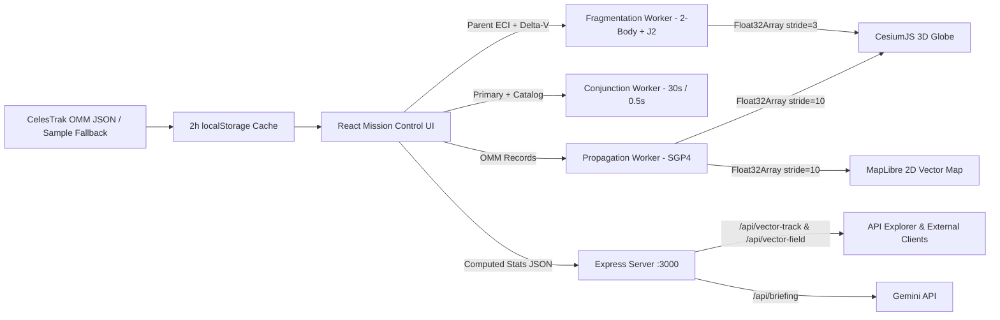

# DEBRISWATCH

**Real-Time Space Debris Simulator, State Vector Tracker, Conjunction Screener & Breakup Analyzer**


**DEBRISWATCH** is an interactive orbital situational awareness platform that propagates thousands of cataloged satellites and fragmentation debris in real time using **SGP4** inside Web Workers, renders synchronized **3D CesiumJS** and **2D MapLibre Vector** views, streams **ECI / ECEF / RTN state vectors** via a REST & GeoJSON API, screens close approaches, simulates orbital breakup clouds, and generates telemetry-grounded executive briefings.

> For deep astrodynamics equations, Worker message schemas, and full JSON API specifications, see **[`DOCUMENTATION.md`](./DOCUMENTATION.md)**.

---

## Key Features

- **Live CelesTrak OMM Feeds + 2-Hour Fair-Use Cache**
  - Ingests Orbit Mean-Elements Message (OMM/JSON) catalogs across 8 groups (`stations`, `active`, `resource`, `weather`, `cosmos-1408-debris`, `fengyun-1c-debris`, `iridium-33-debris`, `cosmos-2251-debris`) via `satellite.json2satrec`.
  - Respects CelesTrak's 2-hour cache policy in `localStorage` (`LIVE DATA` / `CACHED DATA`) and degrades visibly with an error banner and a ~56-object bundled fallback (`SAMPLE DATA`) if live requests are blocked.
- **Tokenless 3D CesiumJS Globe & 2D MapLibre Vector Map (`3D | 2D Vector`)**
  - **3D Globe**: Uses free NASA GIBS Blue Marble, OpenStreetMap Dark, and NASA VIIRS Night Lights imagery with zero Cesium Ion token required, drawing 10,000+ objects via a single `PointPrimitiveCollection` color-coded by class (`Red` = Debris, `Cyan` = Active, `Green` = Earth Observation, `Gold` = Stations, `Orange` = Simulated Breakup Cloud).
  - **2D Vector Map**: Dark vector cartography (`world-atlas` TopoJSON + MapLibre GL) with antimeridian-split orbital ground tracks, velocity heading needles, conjunction arcs, and region AOI overlays.
- **3D/2D State Vector Tracking & REST/GeoJSON API**
  - Streams 10-float transferable `Float32Array` buffers (`ecefX/Y/Z`, `lat/lon/alt`, inertial speed, and `vx/vy/vz` ECEF velocity via the Earth-rotation transport theorem).
  - Visualizes **Velocity ($\vec{v}$)**, **Radial ($\hat{R}$)**, and **Orbit-Normal ($\hat{N}$)** triads in 3D plus multi-shell tangential velocity needles.
  - Exposes live endpoints (`GET /api/vector-track/:noradId`, `GET /api/vector-field`, `GET /api/layer-snapshot`, `GET /api/conjunctions`, `POST /api/briefing`) with an in-app zoomable JSON API Explorer.
- **Two-Stage Conjunction Screening Worker**
  - Coarse apogee/perigee overlap filter → `30 s` coarse ECI sweep with live progress bar → `0.5 s` fine search around local minima (`HIGH < 1 km`, `MEDIUM < 5 km`, `LOW`). Clicking a result pauses at TCA, zooms the camera, and renders both orbits.
- **What-If Fragmentation Tool (`SIMULATED`)**
  - Perturbs parent velocity (`isotropic` or `directional` delta-v cones), converts to Keplerian elements, propagates secular **Two-Body + J2** perturbations, charts 0–4 orbit spread, and counts 24h tracked-object proximity exposure.
- **Zoomable Optical Chase & Live Camera (`1×–24×`)**
  - Interactive Three.js telephoto chase view with Optical, Thermal, and Radar spectral modes, drag-to-pan, timelapse multipliers, fullscreen view, and hardware `getUserMedia` camera toggle.
- **Stats Dashboard, 48h Region Overflight & Gemini AI Briefing**
  - Debris altitude histogram, crowded-shell highlight, 48-hour region pass prediction (`satellite.ecfToLookAngles`) with 2-click globe/map box drawing, and server-side **Gemini** plain-language safety briefings (`POST /api/briefing`).

---

## Architecture Overview



---

## Project Structure

```text
├── DOCUMENTATION.md                  # Full astrodynamics, worker & API reference
├── README.md                         # Repository overview & quick-start guide
├── .env.example                      # Environment variable template
├── index.html                        # App shell & typography imports
├── package.json                      # Scripts & dependencies
├── server.ts                         # Express server, /cesium static mount, Vector & Gemini APIs
├── vite.config.ts                    # Vite config & Cesium static asset copy plugin
└── src/
    ├── App.tsx                       # Main SPA state, simulation loop, workers & layout
    ├── components/
    │   ├── CesiumGlobe.tsx           # Tokenless CesiumJS 3D globe, PointPrimitive & 3D vectors
    │   ├── VectorMap2D.tsx           # MapLibre GL 2D vector ground-track & velocity map
    │   ├── OpticalCameraView.tsx     # 1x-24x Three.js optical chase cam & device camera
    │   ├── ApiInspectorDrawer.tsx    # Zoomable REST & GeoJSON API explorer
    │   ├── FilterPanel.tsx           # Catalog group toggles, LEO/MEO/GEO filter, search & overlays
    │   ├── ObjectCard.tsx            # Live Keplerian + ECI/ECEF/RTN vector telemetry card
    │   ├── ConjunctionPanel.tsx      # Two-stage screening controls & sorted TCA table
    │   ├── FragmentationPanel.tsx    # Breakup simulator controls, exposure & spread chart
    │   ├── StatsAndOverflightPanel.tsx # Shell histogram, 48h overflight AOI & AI briefing
    │   ├── TimeControlsBar.tsx       # Play/Pause, 1x-1000x speed, +/-48h scrubber & UTC clock
    │   └── AboutModal.tsx            # Methodology, uncertainty limits & open-data attributions
    ├── data/
    │   ├── sampleCatalog.ts          # ~56-object fallback OMM dataset (SAMPLE DATA)
    │   └── tleCatalog.ts             # Server-side catalog & ground station reference data
    ├── services/
    │   └── celestrak.ts              # CelesTrak fetcher, 2h localStorage cache & classifier
    ├── types/
    │   └── debriswatch.ts            # Shared TypeScript interfaces
    ├── utils/
    │   └── orbitMath.ts              # ECI/ECEF transport theorem, RTN triad, Kepler & J2 math
    └── workers/
        ├── propagation.worker.ts     # SGP4 worker emitting transferable Float32Array (stride 10)
        ├── conjunction.worker.ts     # Band filter + 30s coarse / 0.5s fine screening worker
        └── fragmentation.worker.ts   # Gaussian delta-v breakup & J2 propagation worker
```

---

## Getting Started

### Prerequisites
- **Node.js** `>= 20.x` (includes `npm`)
- Optional: A **Google Gemini API key** (required only for `POST /api/briefing` AI safety summaries; all orbital simulation, vector tracking, conjunction screening, and fragmentation features run without any API key).

### 1. Clone & Install

```bash
git clone https://github.com/<your-org>/debriswatch.git
cd debriswatch
npm install
```

### 2. Configure Environment Variables

Copy `.env.example` to `.env` (never commit `.env` with real secrets):

```bash
cp .env.example .env
```

```env
# Required only for the server-side Gemini AI Briefing feature (/api/briefing)
GEMINI_API_KEY="your_gemini_api_key_here"

# Optional public URL when deployed
APP_URL="http://localhost:3000"
```

### 3. Run in Development

```bash
npm run dev
```

Open **[http://localhost:3000](http://localhost:3000)**. Express serves `/cesium` static assets (`node_modules/cesium/Build/Cesium`), REST/GeoJSON API routes, and Vite dev middleware on port `3000`.

### 4. Type-Check, Build & Run Production

```bash
# TypeScript verification
npm run lint

# Production bundle (writes dist/ and copies Cesium Assets/Workers/Widgets into dist/cesium/)
npm run build

# Start production server
NODE_ENV=production npm run start
```

---

## REST & GeoJSON API Endpoints

All endpoints are served from `/api/*` and can be inspected interactively inside the app via the **API** button:

| Method & Endpoint | Description | Query / Body |
| :--- | :--- | :--- |
| `GET /api/vector-track/:noradId` | Live SGP4 ECI/ECEF state vectors, RTN basis, kinematics & 30m ephemeris | `?t=<epochMs>` |
| `GET /api/vector-field` | GeoJSON `FeatureCollection` of live `velocity-tangent` `LineString` vectors | `?regime=all\|LEO\|MEO\|GEO&limit=40&t=<ms>` |
| `GET /api/layer-snapshot` | Bbox-filtered GeoJSON points, ground stations, arcs & convergence zones | `?bbox=-180,-90,180,90` |
| `GET /api/orbital-data` | Filtered orbital catalog metadata | `?group=all&regime=all&limit=260&refresh=1` |
| `GET /api/debris/:noradId` | Detailed telemetry & estimate reliability metadata for a target | — |
| `GET /api/conjunctions` | Top close-approach candidates screened across LEO objects | — |
| `GET /api/computed-intel` | Shell instability indices, convergence zones & attributions | — |
| `GET /api/hotspots` | High-density orbital shell focal regions | — |
| `POST /api/briefing` | Plain-language Gemini AI safety briefing from computed telemetry | JSON `BriefingPayload` |
| `GET /api/health` | Service health check (`200 OK`) | — |

### Quick `curl` Examples

```bash
# Live ECI/ECEF/RTN state vectors for ISS (NORAD 25544)
curl -s http://localhost:3000/api/vector-track/25544 | jq .

# GeoJSON velocity tangent vectors for LEO objects
curl -s "http://localhost:3000/api/vector-field?regime=LEO&limit=10" | jq .
```

---

## Controls & Keyboard Shortcuts

| Input | Action |
| :--- | :--- |
| `Space` | Play / Pause simulation clock |
| `ArrowLeft` / `ArrowRight` | Scrub simulation time by `-15 min` / `+15 min` |
| `Shift + ArrowLeft` / `ArrowRight` | Scrub simulation time by `-1 hour` / `+1 hour` |
| `Esc` | Cancel globe/map region box drawing or close open modals |
| Mouse Drag / Scroll | Orbit/zoom 3D Cesium globe, 2D MapLibre map, or Optical Chase Cam |

---

## Accuracy Limits & Disclaimers

- **TLE / OMM Uncertainty**: SGP4 propagation from public General Perturbations (GP/TLE) elements carries kilometer-level positional uncertainty (typically `1–5 km` along-track, growing with epoch age and solar activity). Conjunction screening is strictly for **education and situational awareness**, not operational collision avoidance.
- **Simulated Fragmentation**: Breakup clouds use a simplified **Two-Body + secular $J_2$** educational model and are explicitly badged **`SIMULATED`**.

---

## Open Data & Software Attributions

- **[CelesTrak](https://celestrak.org/)** — Public NORAD GP/OMM orbital element feeds
- **[satellite.js](https://github.com/shashwatak/satellite-js)** — SGP4/SDP4 orbital propagation, GMST & coordinate transforms
- **[CesiumJS](https://cesium.com/platform/cesiumjs/)** (Apache 2.0) — 3D globe rendering & `PointPrimitiveCollection`
- **[MapLibre GL JS](https://maplibre.org/)** & **[world-atlas](https://github.com/topojson/world-atlas)** — 2D vector cartography
- **[NASA GIBS](https://earthdata.nasa.gov/eosdis/science-system-description/eosdis-components/gibs)** & **[OpenStreetMap](https://www.openstreetmap.org/copyright)** (ODbL) — Tokenless Earth base imagery
- **[Three.js](https://threejs.org/)** — Telephoto Optical Chase Camera viewport
- **[Google GenAI SDK](https://www.npmjs.com/package/@google/genai)** — Optional server-side telemetry briefing generation

---

## License

Released under the **Apache-2.0** License.
